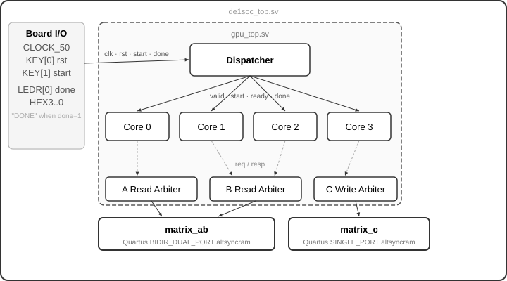
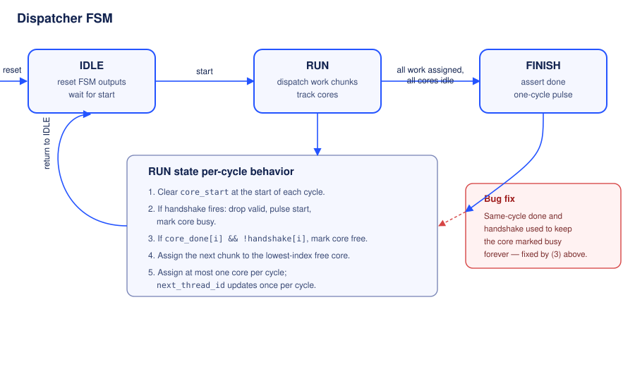
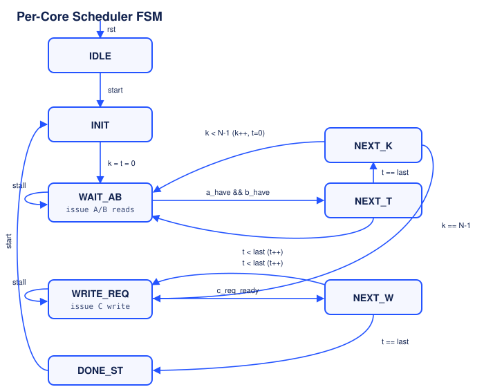
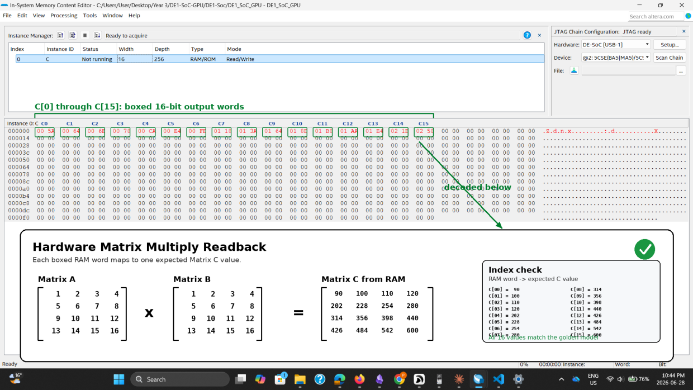

# SIMT Matrix Multiply Accelerator

A fixed-function SIMT accelerator written in SystemVerilog, targeting the Terasic DE1-SoC (Cyclone V). Computes parameterised N×N integer matrix multiplication across multiple hardware cores using a shared-memory arbitration model.

This is the first milestone toward a full SIMT GPU — it does not have an ISA yet, so it is a fixed-function accelerator, not a programmable GPU.

No vendor GPU IP — all RTL is hand-written and verified in ModelSim ASE. The only Quartus IP is the on-chip BRAMs, instantiated outside the accelerator boundary.

**`NUM_CORES = 4` · `THREADS_PER_CORE = 2` · `N = 4` (parameterised)**

---

## Table of Contents

- [Architecture](#architecture)
- [Modules](#modules)
- [Dispatcher](#dispatcher)
- [Scheduler](#scheduler)
- [Arbiters](#arbiters)
- [Hardware Verification](#hardware-verification)
- [Running Simulations](#running-simulations)
- [Roadmap](#roadmap)

---

## Architecture



All four cores share one physical read port per input matrix and one write port for the output matrix, each guarded by a round-robin arbiter. Cores that lose arbitration stall and re-request next cycle — contention is instrumented, not hidden.

`de1soc_top.sv` is the synthesis top. The two Quartus memory IPs (`matrix_ab`, `matrix_c`) are instantiated there, outside `gpu_top`, so the accelerator RTL stays vendor-agnostic. `gpu_top` contains the dispatcher, four cores, and the three arbiters. When the job finishes, the board HEX displays show **DONE**.

**v1 (archived):** 2 cores, one dedicated BRAM port per core. Does not scale past `NUM_CORES = 2`.

**v2 (current):** 4 cores share one physical port per matrix.

```
core 0..3  ──▶  A Read Arbiter  ──▶  matrix_ab (port A)
core 0..3  ──▶  B Read Arbiter  ──▶  matrix_ab (port B)
core 0..3  ──▶  C Write Arbiter ──▶  matrix_c
```

---

## Modules

| Module | Description |
|---|---|
| `dispatcher.sv` | 3-state FSM (IDLE → RUN → FINISH). Distributes work blocks to free cores via valid/ready handshake. |
| `core.sv` | Wraps one scheduler, two threads, A/B response latches, and address MUXes. |
| `scheduler.sv` | 8-state kernel FSM. Issues memory requests and stalls until granted. |
| `thread.sv` | Address generation and FMA accumulation for one C element. |
| `fma.sv` | 1-cycle pipelined fused multiply-accumulate: `result = (a*b) + c`. |
| `rr_read_arbiter.sv` | Round-robin read arbiter. `resp_valid` fires `BRAM_LATENCY` cycles after grant. |
| `rr_write_arbiter.sv` | Round-robin write arbiter. No response path — write commits on grant. |
| `dual_port_bram.sv` | Simulation BRAM model. 1-cycle read latency. |
| `mc_pricer/tausworthe_lfsr.sv` | LFSR113 uniform RNG for the Monte Carlo pricer (in progress). |

---

## Dispatcher



`dispatcher.sv` manages a pool of cores with a 3-state FSM. The interesting challenge is avoiding races during re-dispatch.

**Design choices worth noting:**

- **Same-cycle done/start guard.** When a core finishes and the dispatcher immediately reassigns it, `core_done[i]` is still high for exactly one cycle while `core_start[i]` has been pulsed but hasn't arrived yet. Without a guard, the dispatcher's completion-handler would see `done=1` and clear the busy bit it just set, handing the core a third block on top of a still-running one. The fix: `if (core_done[i] && !handshake[i])` — a core being handshaked this cycle is exempt from the completion scan.

- **One handshake per cycle.** `next_thread_id` advances once per cycle, preventing two blocks being dispatched to different cores in a single clock edge.

- **Sticky done.** `done` in `scheduler.sv` is `assign done = done_r && !start` — combinationally forced low the instant `start` arrives, so the dispatcher can never see a stale `done=1` on the same cycle it sends `start`.

---

## Scheduler



`scheduler.sv` is the 8-state kernel FSM inside each core. It drives the inner-product loop `k = 0..N-1` across `t = 0..THREADS_PER_CORE-1` threads.

| State | Action |
|---|---|
| `IDLE` | Wait for `start`. Reset counters. |
| `INIT` | Assert `kernel_init` to zero thread accumulators. |
| `WAIT_AB` | Issue A/B read requests. Stall until both `a_have` and `b_have`. Pulse `fma_en[t]`. |
| `NEXT_T` | Advance thread index. Loop back to `WAIT_AB` or advance to `NEXT_K`. |
| `NEXT_K` | Advance k. Loop back to `WAIT_AB` (k < N-1) or proceed to write phase (k = N-1). |
| `WRITE_REQ` | Issue C write request. Stall until `c_req_ready`. |
| `NEXT_W` | Advance write-phase thread index. Loop or finish. |
| `DONE_ST` | Hold until `rst` or next `start`. |

**Design choices worth noting:**

- **Independent A and B requests.** The two read arbiters are fully independent — a core can win the A arbiter one cycle and the B arbiter a different cycle. The scheduler tracks `a_inflight` and `b_inflight` to avoid re-asserting a request that has already been granted but whose data hasn't arrived yet, and only pulses `fma_en[t]` once both `a_have` and `b_have` are set.

- **Stall on contention.** `WAIT_AB` and `WRITE_REQ` re-assert their request every cycle until `req_ready` is received. The scheduler never drops a request mid-flight.

- **A/B response latches in `core.sv`.** BRAM read data is only valid for one cycle on the shared port. The latches in `core.sv` capture `resp_data` on `resp_valid` and hold it stable until `fma_en[t]` fires — necessary because the two operands can arrive on different cycles.

---

## Arbiters

`rr_read_arbiter.sv` and `rr_write_arbiter.sv` implement the same round-robin policy. The most interesting design point is latency handling.

**Grant is combinational.** `req_ready` (the grant signal) is driven the same cycle as `req_valid`. The winning core's address hits the BRAM that same cycle.

**Parameterised response pipeline.** After a grant, `resp_valid` fires `BRAM_LATENCY` cycles later — implemented as a shift register `grant_pipe[BRAM_LATENCY]`. This single parameter bridges a real hardware/simulation mismatch:

| Target | `BRAM_LATENCY` | Why |
|---|---|---|
| `dual_port_bram` (simulation) | `1` | Registered output, combinational address |
| `matrix_ab` altsyncram IP (hardware) | `2` | Registered address **and** registered output |

`de1soc_top` overrides to `BRAM_READ_LATENCY=2`. Without this, every core read one grant early, producing a systematic corruption across all of matrix C — visible on hardware but invisible in simulation until a hardware-accurate testbench was written.

---

## Hardware Verification

Beyond simulation, the design was verified against a golden model directly on the DE1-SoC using the Quartus In-System Memory Content Editor to read back `matrix_c` live from BRAM. Diagrams and this capture are from our shared write-up in [pouyahatami/simt-matrix-multiply-accel](https://github.com/pouyahatami/simt-matrix-multiply-accel):



Each boxed RAM word maps to one expected `C` value from the 4×4 matrix multiply; all 16 values matched.

---

## Running Simulations

Each module that has a ModelSim script can be run from a Tcl console. The portable scripts derive the project root from their own location, so they work from any directory:

```tcl
do tb/scheduler/run.do
do tb/core/run.do
do tb/arbiter/run_read.do
do tb/arbiter/run_write.do
do tb/mc_pricer/run_rng.do
```

Full system test (simulation BRAMs):

```tcl
do tb/Top/run.do
```

Hardware-accurate top test (Quartus `matrix_ab` / `matrix_c` models):

```tcl
do tb/Top/run_hw.do
```

All of these compile from `rtl/` directly.

---

## Roadmap

### Done

- [x] Round-robin read/write arbiters with parameterised `BRAM_LATENCY`
- [x] 4-core shared-memory architecture (v2)
- [x] Dispatcher valid/ready handshake, including same-cycle done/start guard
- [x] Contention instrumentation (`stall_cycles`, `grant_count`)
- [x] Unit testbenches for dispatcher, scheduler, cores, and arbiters
- [x] DE1-SoC synthesis project (Quartus)
- [x] HEX display shows **DONE** on completion
- [x] On-board golden-model check via In-System Memory Content Editor
- [x] LFSR113 uniform RNG for the Monte Carlo option pricer

### Next Steps

- [ ] Box–Muller transform, GBM path update, and payoff accumulator
- [ ] Define a minimal ISA (load/store/FMA/branch)
- [ ] Build a scalar programmable core (replace fixed-function thread/scheduler)
- [ ] Extend to true SIMT (shared PC, per-thread register file, active mask)
- [ ] Re-attach SIMT datapath to existing arbiters
- [ ] Hand-assemble and run a matmul kernel on the programmable core
- [ ] Add SVA assertions to arbiters and dispatcher
